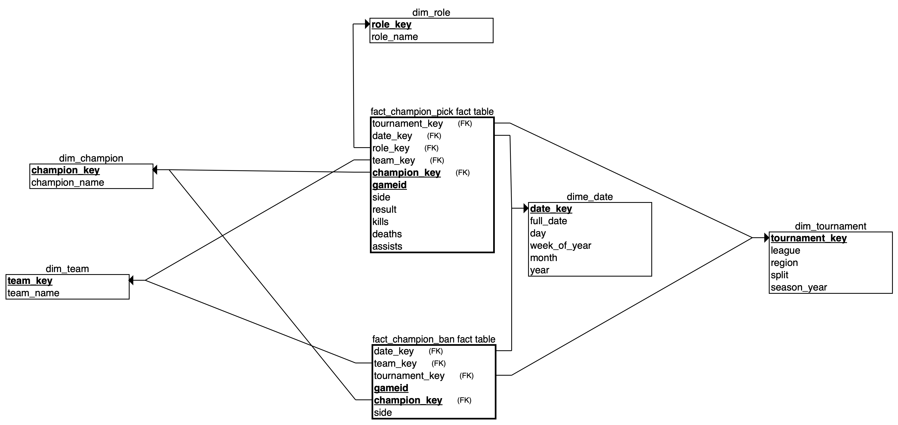
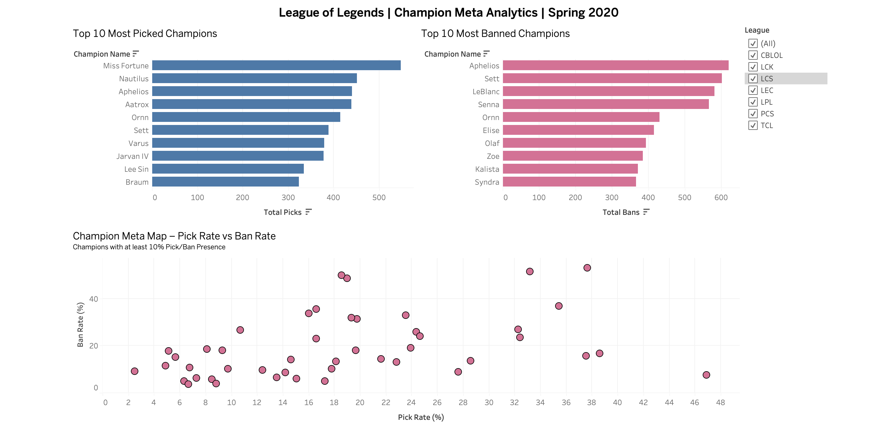
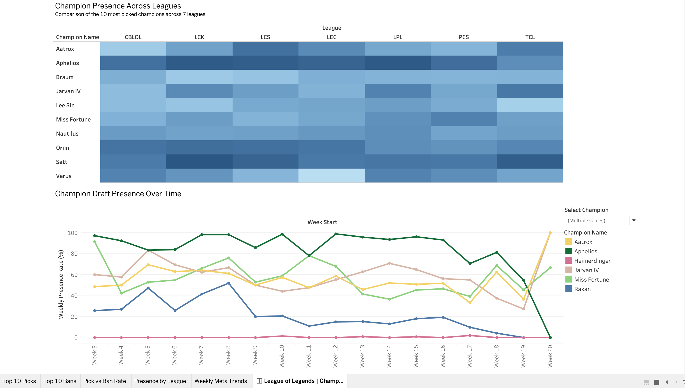

# League of Legends Champion Meta Analytics — Spring 2020

A **Data Warehousing and Business Intelligence portfolio project** exploring champion picks, bans, draft presence, and regional meta trends in professional League of Legends during Spring 2020.

## 1. Project Overview

Professional League of Legends match data contains detailed draft information, but raw match records are difficult to aggregate and compare consistently across champions, leagues, and time periods.

This project transforms historical match data into a PostgreSQL data warehouse and analytical datasets for an interactive Tableau dashboard. The analysis focuses on **what defined the Spring 2020 champion meta**, how champion priorities varied across leagues, and how those priorities evolved during the season.

### Project Background

This project originated from a practical exercise in the **Data Warehousing** course at **Frankfurt University of Applied Sciences**, where we explored data warehouse schema design.

Inspired by that exercise, I independently extended the concept into a personal portfolio project using real-world League of Legends esports data. I implemented a Galaxy Schema in PostgreSQL, developed data loading and transformation workflows using Python and SQL, validated the analytical results, and built an interactive Tableau dashboard.

### Analytical Scope

- **Season:** Spring 2020
- **Leagues:** CBLOL, LCK, LCS, LEC, LPL, PCS, and TCL
- **Focus:** Champion picks, bans, draft presence, regional comparisons, and weekly trends
- **Excluded from analysis:** LCS.A
- **Not in scope:** Current season recommendations, counter pick recommendations

## 2. Business Questions

The project addresses four analytical questions:

1. **Champion popularity:** Which champions were picked and banned most frequently during Spring 2020?
2. **Draft presence:** Which champions were most prominent in the pick/ban phase?
3. **Regional comparison:** How did champion draft priorities vary across professional leagues?
4. **Meta evolution:** How did champion draft presence change over the course of Spring 2020?

These questions guide the analytical views, KPIs, and dashboard visualizations.

## 3. Technology Stack

| Technology | Role |
| --- | --- |
| Python, pandas | Data profiling and staging data import |
| PostgreSQL | Relational data warehouse and SQL analytical views |
| SQL | Dimensional modeling, transformations, aggregation, and validation |
| Tableau Public | Interactive champion meta dashboard |
| Git & GitHub | Version control and project documentation |

## 4. Data Source

**Source:** Oracle's Elixir — professional League of Legends match data for Spring 2020.

The original match-level CSV is loaded into a PostgreSQL staging table before transformation into the dimensional model. The analysis covers seven professional leagues; `LCS.A` is excluded from the analytical scope.

This is a **historical analysis** of Spring 2020, not a representation of the current competitive meta.

## 5. Data Warehouse Architecture

The PostgreSQL warehouse uses a **Galaxy Schema (fact constellation)** with two fact tables and shared dimensions.

### Fact Tables

- `fact_champion_pick` — records champion picks in individual matches.
- `fact_champion_ban` — records champion bans in individual matches.

### Dimension Tables

- `dim_champion` — champion information.
- `dim_team` — team information.
- `dim_role` — player role information.
- `dim_date` — calendar attributes for match dates.
- `dim_tournament` — league/tournament information.

The fact tables are analyzed separately before aggregation to avoid duplicating counts through direct fact-to-fact joins.

### Schema Diagram




### Analytical Views

Two PostgreSQL views support different analytical grains:

| View | Grain | Purpose |
| --- | --- | --- |
| `vw_champion_meta` | Champion × League | Season-level pick, ban, and presence comparisons |
| `vw_champion_meta_weekly` | Champion × League × Week | Weekly champion draft-presence trends |

Keeping these views separate preserves the season level grain used by the existing dashboard charts.

## 6. Data Pipeline

The workflow follows these steps:

1. **Profile the raw dataset** using Python and pandas.
2. **Load staging data** from the source CSV into PostgreSQL.
3. **Create dimensions and facts** according to the warehouse model.
4. **Populate dimension tables**, then load pick and ban facts.
5. **Validate data quality** and compare aggregated results.
6. **Build analytical SQL views** for season level and weekly reporting.
7. **Export view results as CSV** for use in Tableau Public.
8. **Create interactive visualizations** to answer the business questions.

The SQL scripts are organized in the `sql/` directory:

```text
sql/
├── 1_create_dimensions.sql
├── 2_create_facts.sql
├── 3_load_dimensions.sql
├── 4_load_facts.sql
├── 5_data_validation.sql
└── 6_analytics.sql
```

Python scripts and profiling notebooks are stored in `scripts/` and `notebooks/`, respectively.

## 7. KPI Definitions

All rates use the number of games in the relevant analytical scope as the denominator.

| KPI | Definition |
| --- | --- |
| **Total Picks** | Number of games in which the champion was picked |
| **Total Bans** | Number of games in which the champion was banned |
| **Pick Rate (%)** | `Total Picks / Total Games × 100` |
| **Ban Rate (%)** | `Total Bans / Total Games × 100` |
| **Presence Rate (%)** | `(Total Picks + Total Bans) / Total Games × 100` |

**Aggregation rule:** When combining multiple leagues or weeks, rates are recalculated from the **summed counts and summed game totals**, rather than taking an unweighted average of percentages.

**Weekly analysis:** `Total Games` is calculated for each league and week. Weeks with no games are not treated as weeks with 0% presence; they have no match observations.

## 8. Tableau Dashboard

The dashboard contains five visualizations aligned with the business questions:

| Visualization | Analytical purpose |
| --- | --- |
| **Top 10 Most Picked Champions** | Identify the most frequently selected champions |
| **Top 10 Most Banned Champions** | Identify the most frequently banned champions |
| **Pick Rate vs. Ban Rate** | Explore the relationship between selection and ban frequency |
| **Champion Presence Across Leagues** | Compare draft presence across the seven leagues |
| **Champion Draft Presence Over Time** | Track changes in champion presence by week |

The dashboard includes league and champion filters where appropriate. The cross-league heatmap retains all seven leagues to support regional comparison.

### Dashboard Preview




### Tableau Workbook

The packaged Tableau workbook is stored at [`tableau/champion_meta.twbx`](tableau/champion_meta.twbx).

The Tableau data exports are stored in `data/`:

- `champion_meta.csv` — season level analytical dataset.
- `champion_meta_weekly.csv` — weekly analytical dataset.

## 9. Data Quality and Validation

Validation SQL is maintained in [`sql/5_data_validation.sql`](sql/5_data_validation.sql). Checks cover the transformed pick/ban records and relationships between staging, dimensions, facts, and analytical outputs.

A reconciliation query compares **the sum of weekly champion picks and bans** with the corresponding **season-level totals** for matching champion league combinations. This check returned **zero mismatched rows** during development.

This reconciliation is one consistency check, not proof that every possible data quality issue has been eliminated. In particular, it does not by itself detect champion–league combinations missing entirely from one of the views.

## 10. Repository Structure

```text
lol_prj/
├── data/                 # Source and exported analytical CSVs
├── image/                # Schema and dashboard images
├── notebooks/            # Data profiling notebook
├── scripts/              # Python staging loader
├── sql/                  # Warehouse DDL, loading, validation, analytics
├── tableau/              # Packaged Tableau workbook
├── .gitignore
└── README.md
```

## 11. Future Improvements

- Visualize the Galaxy Schema relationships in **Power BI**.
- Add a concise, reproducible setup guide with the required PostgreSQL configuration and script execution order.
- Automate analytical exports instead of exporting view results manually.
- Extend the analysis to additional seasons or patches, with appropriate normalization and scope checks.

---

*This is an independently extended educational portfolio project based on a practical university course exercise. Its analytical conclusions are limited to the available Spring 2020 match data.*
